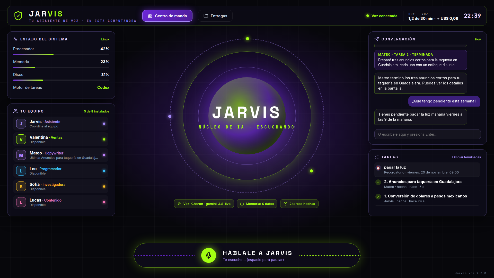

# Jarvis Voz

**Tu asistente de voz en el navegador de tu computadora.** Le hablas por el micrófono, te responde hablando en tiempo real, y cuando le pides trabajo de verdad (investigar, escribir, crear archivos, programar) lo hace en segundo plano en tu computadora y te avisa con la voz cuando termina.

- **Voz:** Gemini Live (Google), con interrupción: hablas encima y se calla.
- **Manos:** Claude Code (o Codex / Gemini CLI) corriendo tareas en tu computadora.
- **Equipo por voz:** "Mateo, escribe 3 anuncios para mi taquería" → tarea para el especialista → aviso hablado con el resultado.
- **Recordatorios:** "Recuérdame pagar la luz el viernes a las 9" → a la hora, te lo dice.
- **Centro de mando:** núcleo que reacciona a tu voz, equipo con estado real, tareas, conversación y estado de tu computadora.
- **Privado:** el servidor solo escucha en tu computadora (`127.0.0.1`). Nada queda abierto a internet.



## Requisitos

| Qué | Para qué | Costo |
|---|---|---|
| Windows 10/11, macOS 13+ o Linux | Donde corre | — |
| Chrome o Edge | La página del centro de mando | Gratis |
| Cuenta de **Claude** con plan **Pro o superior** | Claude Code hace las tareas | Pro: US$ 20/mes (US$ 17/mes en plan anual). El plan gratis de Claude no incluye Claude Code |
| Clave de **Gemini** (Google AI Studio) | La voz en tiempo real | Gratis con límites; en el plan pago ≈ US$ 0,03 por minuto de conversación |
| Micrófono y parlantes (o auriculares) | Hablar y escuchar | — |

El instalador instala solo lo demás (Node.js, Git en Windows y Claude Code).

## Instalación

Baja el instalador de tu sistema desde la [última versión](https://github.com/unixlira/jarvis-voz/releases/latest) y ábrelo con doble clic:

| Sistema | Archivo | Aviso del sistema |
|---|---|---|
| Windows | `instalar-jarvis-voz-windows.zip` → `instalar-jarvis-voz.bat` | SmartScreen: **Más información › Ejecutar de todas formas** |
| Mac | `instalar-jarvis-voz-mac.zip` → `instalar-jarvis-voz.command` | **Clic derecho › Abrir › Abrir** (la primera vez) |
| Linux | `instalar-jarvis-voz-linux.sh` | `bash instalar-jarvis-voz-linux.sh` |

O en una línea:

```powershell
# Windows (PowerShell)
irm https://raw.githubusercontent.com/unixlira/jarvis-voz/main/instaladores/windows/instalar-jarvis-voz.ps1 | iex
```

```bash
# Mac / Linux
curl -fsSL https://raw.githubusercontent.com/unixlira/jarvis-voz/main/instaladores/mac-linux/instalar-jarvis-voz.sh | bash
```

El instalador te pide solo dos cosas: **entrar en tu cuenta de Claude** (se abre el navegador) y **pegar tu clave de Gemini** (con el enlace para crearla). Después instala todo, crea el acceso directo **Jarvis Voz** en el escritorio y abre la página. Correrlo de nuevo actualiza a la última versión sin borrar tu configuración, tu memoria ni tus entregas.

## Uso

1. Doble clic en **Jarvis Voz** (escritorio).
2. Clic en el micrófono (o barra espaciadora) y háblale.
3. Lo que las tareas producen queda en `JarvisVoz/espacio/entregas` (botón **Entregas**).

## Equipo de especialistas (opcional)

Cada especialista es una carpeta con un `SKILL.md`. Copia la carpeta (por ejemplo `copywriter/`) dentro de `JarvisVoz/espacio/.claude/skills/` y ya aparece en "Tu equipo". Los nombres conocidos: Valentina (`vendedora`), Mateo (`copywriter`), Leo (`programador`), Sofía (`investigadora`), Lucas (`contenido`), Camila (`atencion`), Diego (`trafico`), Paula (`disenadora`), Nico (`videos`), Martina (`redes`). Si le hablas a un especialista que no tienes, Jarvis hace la tarea él mismo y te avisa.

## Configuración

Todo está en `JarvisVoz/.env` (ver `env.ejemplo`): nombre del asistente, voz, minutos de voz por día, motores de tareas, etc. Diagnóstico: `node server.mjs --diagnostico` dentro de la carpeta.

## Desinstalar

Windows: `JarvisVoz\instaladores\windows\desinstalar-jarvis-voz.bat`. Mac/Linux: `~/JarvisVoz/instaladores/mac-linux/desinstalar-jarvis-voz.sh`. Te pregunta antes de borrar tus entregas.

## Seguridad

- El servidor escucha solo en `127.0.0.1`; la página pide una llave local (el acceso directo la pasa) y rechaza otros orígenes.
- Tu clave de Gemini queda en `.env`, legible solo por tu usuario.
- Las tareas trabajan en `espacio/` y se detienen a pedir tu OK antes de borrar, pagar, publicar, enviar o instalar algo.

## Licencia

MIT. "Jarvis" es solo el nombre por defecto del asistente (puedes cambiarlo en `.env`); este proyecto no tiene relación con Marvel ni con Anthropic, OpenAI o Google.
